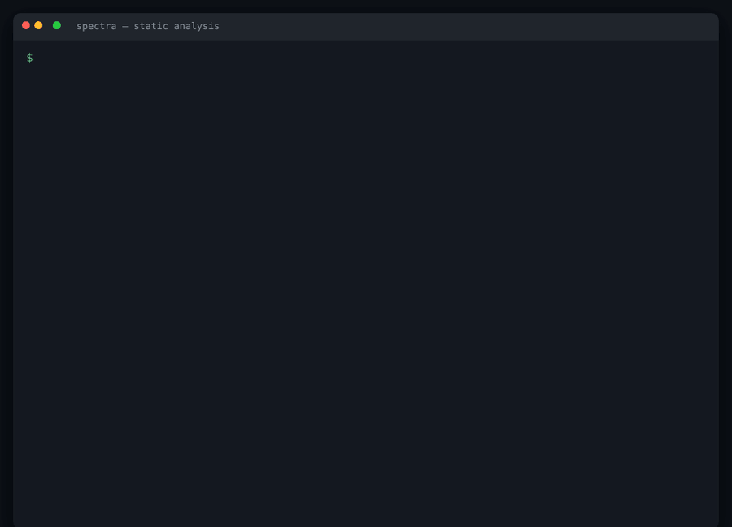
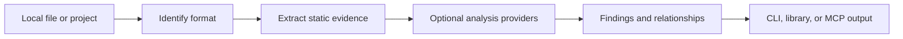

<div align="center">

# 🛰️ SpectraProbe


### Original open-source static software analysis toolkit

**Identify, hash and inspect executables, archives, WebAssembly and JavaScript — from one CLI, one library, and a real MCP server. No cloud. No telemetry. Everything runs locally.**

[](https://github.com/Ethos6/spectraprobe/actions/workflows/ci.yml)
[](https://github.com/Ethos6/spectraprobe/releases)
[](LICENSE)
[](package.json)
[](tsconfig.json)
[](#-mcp-server)

[Quick start](#-quick-start) · [What it does](#-what-it-does) · [CLI](#-cli) · [MCP server](#-mcp-server) · [Providers](#-pluggable-providers) · [Library](#-library-api) · [Scope & ethics](#-authorized-use)



<sub>Real output from <code>spectra inspect</code> and <code>spectra diff</code> on system binaries. Re-record with <code>python scripts/record_demo.py</code>.</sub>

</div>

---

## How it works

SpectraProbe identifies a local file from its format, extracts static evidence with format-aware readers and optional analysis providers, then presents findings through the CLI, library, or MCP server. Input files are inspected, never executed.



## Why

Reverse-engineering and defensive investigation usually mean juggling a dozen single-purpose tools: one for file identification, one for hashing, one for strings, another for PE headers, another for ELF, something else for archives. **SpectraProbe** unifies the *static* foundation of that workflow behind one consistent interface, with a data model built for evidence:

- **Zero required native dependencies.** The PE, ELF, Mach-O, WebAssembly and ZIP parsers are original TypeScript. Install and run.
- **One engine, three front ends.** The same analysis core powers the CLI, the programmatic library, and an MCP server — so results are identical everywhere.
- **Evidence, not vibes.** Every conclusion is a *finding* that cites concrete *evidence*, labelled `verified`, `inferred` or `unknown`, with explicit limitations. Nothing is invented.
- **Graceful degradation.** Heavy external tools (Ghidra, radare2, YARA, JADX, …) are optional *providers*; the core works fully without them and reports exactly what is and isn't installed.

```console
$ spectra inspect ./sample.exe
▌ sample.exe
  format   pe — PE (Portable Executable)
  sha256   9f2c…c4cd
  entropy  6.47 bits/byte

metadata
  [vh] PE PE32+ for x86-64 (AMD64) (DLL)
       subsystem: Windows GUI; entry RVA 0x1240; image base 0x180000000
import
  [vh] Imports 86 functions from 7 libraries
hardening
  [vh] Security flags: dynamic-base (ASLR), nx-compatible (DEP), control-flow-guard
```

## ✨ What it does

| Area | Capability |
|---|---|
| **Identification** | Magic-byte detection for PE, ELF, Mach-O (incl. fat/universal), WebAssembly, ZIP/JAR/APK, Java class, DEX, JS/TS, text |
| **Integrity** | SHA-256 / SHA-1 / MD5 / CRC-32, size, Shannon entropy with packing hints |
| **Strings & IOCs** | ASCII + UTF-16LE extraction; pulls out URLs, IPs, emails, domains and file paths |
| **PE** | Machine, bitness, subsystem, entry point, image base, timestamp, sections, **imports (by name & ordinal)**, exports, ASLR/DEP/CFG flags, .NET detection |
| **ELF** | Class, type, machine, sections, **`DT_NEEDED` dependencies**, SONAME, RPATH, dynamic symbols, stripped detection |
| **Mach-O** | 32/64-bit, fat binaries, CPU type, file type, UUID, sections, linked dylibs, min-OS |
| **WebAssembly** | Section table, imports and exports with names and kinds, custom sections |
| **Archives** | ZIP/JAR/APK entry listing; JAR manifest; APK DEX/manifest summary (reads deflate & stored entries) |
| **JavaScript / TS** | Real **acorn AST** for JS (imports, requires, exports, functions, classes, `eval`/dynamic `import`), capability-reference hints; regex fallback for TypeScript; whole-project module graph |
| **Diff** | `spectra diff old new` compares two builds: added/removed imports, exports, dependencies, symbols, indicators and sections, ranked by size change. Exit code 1 when they differ, like `diff` |
| **Evidence model** | Findings cite evidence, carry certainty/confidence and limitations; searchable sessions persisted to disk |
| **Knowledge graph** | Relationship graph linking artifacts ↔ imports, exports, dependencies, sections, indicators |
| **Reporting** | Terminal, JSON and Markdown reports with reproducibility metadata |

> SpectraProbe performs **static** analysis only — it reads and parses files, it never executes the software under study.

## 🚀 Quick start

```bash
git clone https://github.com/Ethos6/spectraprobe
cd spectraprobe
npm install
npm run build
npm test            # 45 tests across parsers, pipeline, diff, and the MCP layer

# analyse something real
node dist/cli/cli.js inspect "$(command -v node)"
```

Install the `spectra` command globally from the clone:

```bash
npm link           # then: spectra inspect ./target
```

> Requires Node.js ≥ 18. Works on Windows 11, Linux and macOS (CI runs on all three).

## ⌨️ CLI

```text
spectra inspect <target>        Full static analysis (findings, metadata, structure)
spectra strings <file>          Extract printable ASCII/UTF-16 strings
spectra dependencies <target>   Linked libraries / package dependencies
spectra symbols <file>          Exported / dynamic symbols
spectra imports <file>          Imported libraries and functions
spectra js analyze <path>       Analyse a JS/TS file or project
spectra resources <file>        List archive entries / embedded resources
spectra providers               List external providers and availability
spectra report <target>         Full report  (--format markdown|json  --out file)
spectra graph <target>          Emit the knowledge graph as JSON
spectra diff <old> <new>        Compare two builds (exit 1 if they differ)
spectra mcp                     Start the MCP server (stdio)
```

Common options: `--format terminal|json|markdown`, `--out <file>`, `--only strings,imports`, `--min-length <n>`, `--max-strings <n>`, `--no-color`.

```bash
# A whole JS/Node project: dependencies + capability references + module graph
spectra js analyze ./my-app

# A shareable Markdown report for an issue or case file
spectra report ./firmware.bin --format markdown --out firmware.md

# Just the import table of a DLL, as JSON
spectra imports ./library.dll --format json

# What changed between two releases? New imports, dropped libraries, new URLs…
spectra diff ./app-1.4.exe ./app-1.5.exe
```

## 🔌 MCP server

SpectraProbe speaks the Model Context Protocol over stdio, so any MCP-compatible client or agent can drive the engine. It implements the protocol directly — no SDK dependency.

```jsonc
// add to your MCP client configuration
{
  "mcpServers": {
    "spectraprobe": { "command": "spectra", "args": ["mcp"] }
  }
}
```

Thirteen tools, each backed by the same engine as the CLI:

`probe_target` · `inspect_metadata` · `extract_strings` · `inspect_dependencies` · `inspect_symbols` · `inspect_imports` · `analyze_javascript` · `inspect_resources` · `diff_targets` · `search_evidence` · `create_report` · `list_providers` · `get_analysis_status`

Each tool has an explicit input schema, returns structured JSON, and reports clear errors for unsupported operations. Requests are processed in order so session-aware tools (`search_evidence`, `get_analysis_status`) stay consistent. A quick manual check:

```bash
printf '%s\n' \
  '{"jsonrpc":"2.0","id":1,"method":"initialize","params":{"protocolVersion":"2024-11-05"}}' \
  '{"jsonrpc":"2.0","id":2,"method":"tools/list"}' \
  '{"jsonrpc":"2.0","id":3,"method":"tools/call","params":{"name":"probe_target","arguments":{"path":"/bin/ls"}}}' \
  | spectra mcp
```

## 🧩 Pluggable providers

Deeper analysis comes from established, independently-licensed tools. SpectraProbe *detects and adapts* them; it never bundles them, and it keeps working when they are absent.

| Provider | Adds | Detected via |
|---|---|---|
| **YARA** | signature/pattern scanning | `yara` on PATH |
| **radare2** | disassembly & analysis | `r2` on PATH |
| **Capstone** | multi-arch disassembly | `python3 -c import capstone` |
| **LIEF** | cross-format binary abstraction | `python3 -c import lief` |
| **Ghidra** | decompilation, deep analysis | `GHIDRA_INSTALL_DIR` or `analyzeHeadless` |
| **JADX** | APK/DEX → Java | `jadx` on PATH |
| **Java** | JVM-based tooling | `java` on PATH |

```bash
spectra providers            # shows ✓/✗, version, supported formats, and install notes
```

Each provider honours the licence and distribution terms of the tool it wraps.

## 📚 Library API

```ts
import { analyzePath, buildGraph, renderReport } from "spectraprobe";

const report = await analyzePath("./sample.exe");
console.log(report.findings.filter((f) => f.category === "import"));

const graph = buildGraph([report]);        // nodes + edges you can render or query
const markdown = renderReport(report, "markdown");
```

Lower-level parsers are exported too: `parsePe`, `parseElf`, `parseMacho`, `parseWasm`, `readZip`, `extractStrings`, `shannonEntropy`, `hashBuffer`, and more.

## 🏗️ Architecture

```
ingest ─▶ identify (magic bytes) ─▶ static engines ─▶ evidence/findings ─▶ report
                                     ├─ formats: pe · elf · macho · wasm · zip
                                     ├─ analyze: javascript (acorn) · project walk
                                     └─ providers: yara · radare2 · ghidra · …(optional)
                                                   │
                      session (searchable) ◀───────┤
                      knowledge graph      ◀───────┘
        the same core is exposed by  →  CLI · library · MCP server
```

Independently testable subsystems, TypeScript strict mode, bounds-checked binary readers, hard timeouts on any external process, and no file is ever executed.

## 🛡️ Authorized use

SpectraProbe is built for **defensive security, debugging, interoperability research, and authorized software investigation**. Use it only on:

- software you develop or own,
- open-source software,
- malware/research samples in an environment you control, or
- targets you otherwise have a lawful basis to analyse.

By design, this project is **static-only**. It deliberately does **not** include runtime hooking, stealth process/network monitoring, access-control or DRM circumvention, credential capture, or persistence mechanisms. Respect the licences of anything you analyse and of every provider tool you enable. You are responsible for using it lawfully.

## ✅ Project status

Implemented and tested: ingestion, hashing, entropy, strings/IOCs, PE/ELF/Mach-O/WASM/ZIP parsers, JS/TS analysis, build diffing, provider detection, evidence model, knowledge graph, sessions, reporting, CLI, and the MCP server (45 passing tests; typechecked; CI on Linux/macOS/Windows × Node 18/20/22).

Planned: optional provider *adapters* that invoke Ghidra/radare2/JADX for decompilation, richer `.NET` and DEX structure parsing, and a desktop workspace. Runtime/dynamic analysis is intentionally out of scope.

## 🤝 Contributing

Issues and PRs welcome — new format parsers, provider adapters, and fixtures especially. See [CONTRIBUTING.md](CONTRIBUTING.md). Please include a deterministic test fixture for any new parser.

## Related projects

- [free-search-api](https://github.com/Ethos6/free-search-api) — self-hosted web search API
- [free-news-api](https://github.com/Ethos6/free-news-api) — news aggregation API
- [free-flight-api](https://github.com/Ethos6/free-flight-api) — live flight tracking API
- [free-ocr-api](https://github.com/Ethos6/free-ocr-api) — OCR & document data extraction

---

<div align="center">

**If SpectraProbe is useful to you, please ⭐ the repo** — it helps other researchers find it.

MIT © Ethos6

</div>
